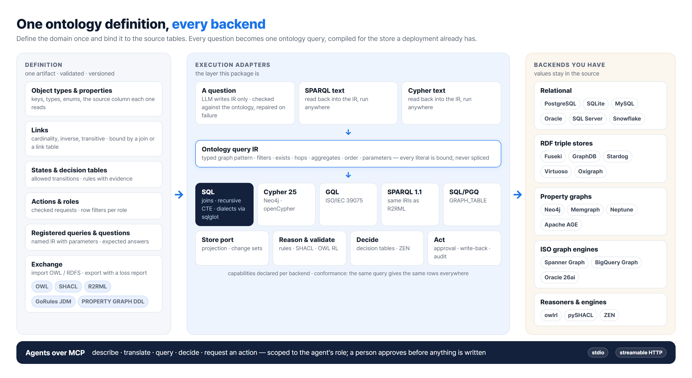
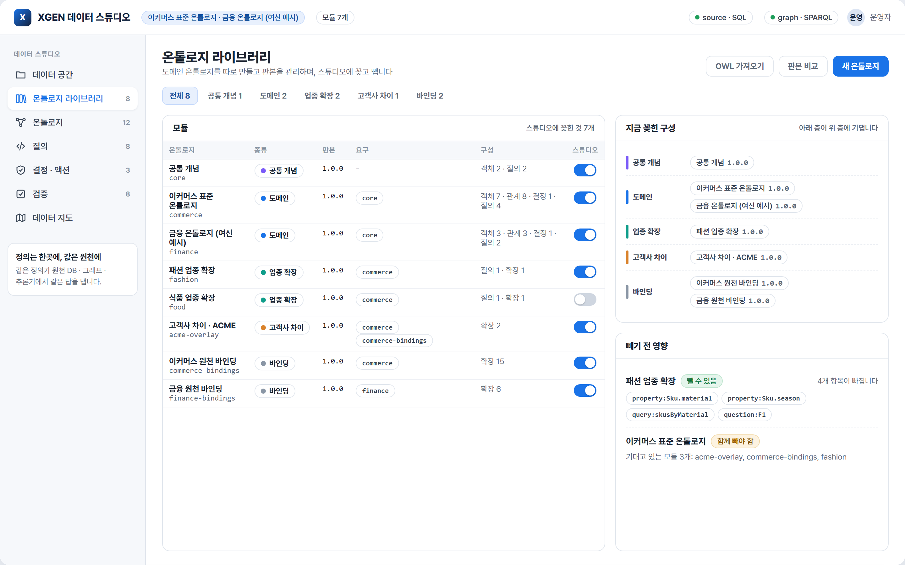
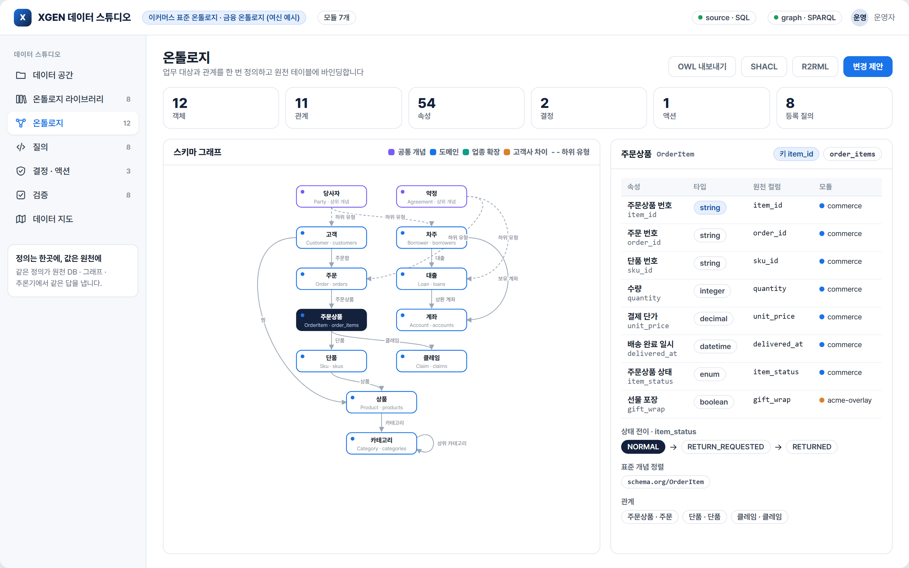
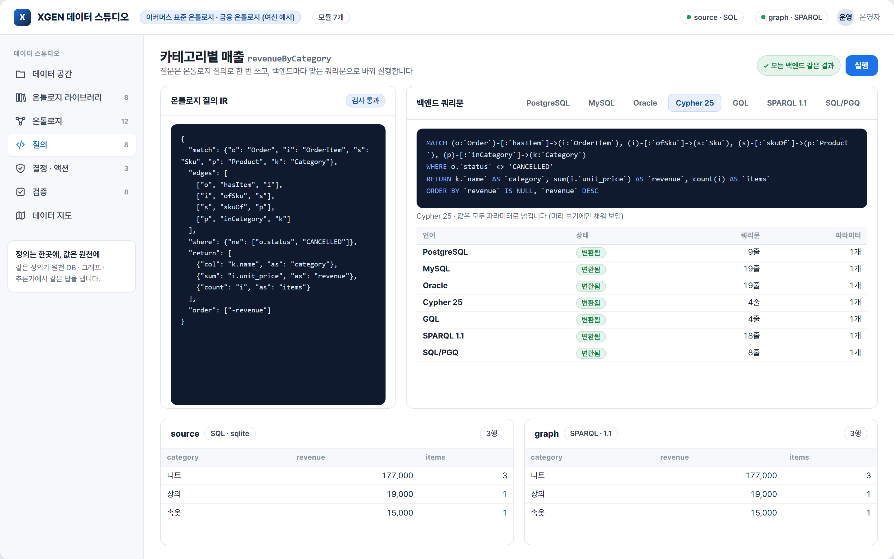
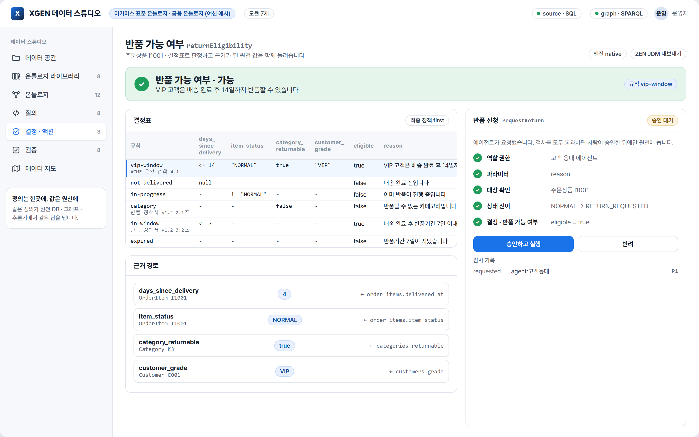
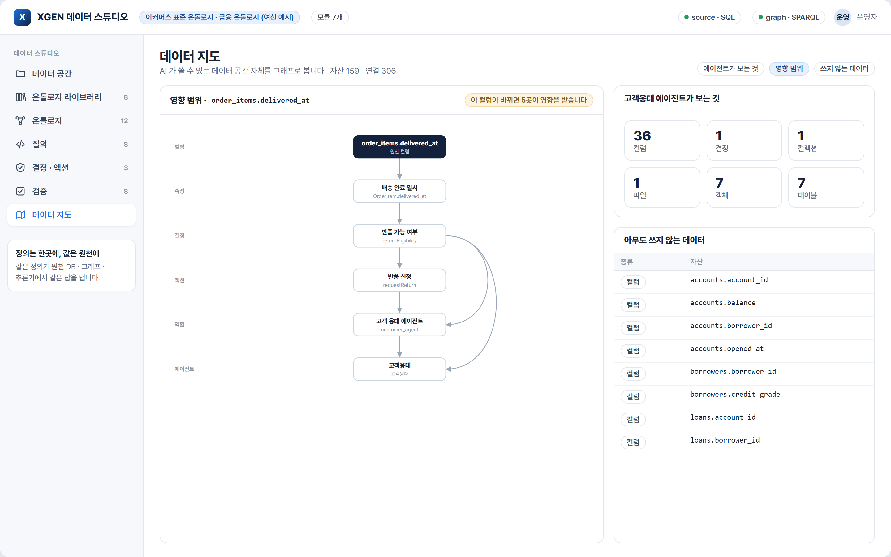

# xgen-data-studio

**One domain ontology, executed wherever the data already lives.** Describe the business once — object
types, properties, links, states, decisions, actions, roles — and bind it to the source tables. A question
then becomes *one* ontology query, and the studio compiles it for the store a deployment actually has:
SQL in any dialect, Cypher, ISO GQL, SPARQL or SQL/PGQ. SPARQL and Cypher written by people or agents are read
back into the same query, so they run on any of those stores too. **Zero hard dependencies, zero infra to try it.**

```python
from xgen_data_studio import Ontology
from xgen_data_studio.studio import Studio
from xgen_data_studio.backends.sql import SqliteBackend
from xgen_data_studio.backends.rdf import RdflibBackend

studio = Studio(Ontology.load("examples/commerce/ontology.yaml").check())
studio.add_backend("source", SqliteBackend()).script(open("examples/commerce/seed.sql", encoding="utf-8").read())
studio.add_backend("graph", RdflibBackend())        # a graph only when you want one
studio.project()                                   # source rows -> RDF; later calls send only what changed

studio.run("revenueByCategory")                    # compiled to SQL, run on the source
studio.run("revenueByCategory", backend="graph")   # the same query as SPARQL, the same rows
studio.translate("revenueByCategory", "sql:oracle").text      # or cypher, gql, sparql, sqlpgq, sql:mysql, ...
studio.run_cypher("MATCH (o:Order)-[:hasItem]->(i:OrderItem) RETURN o.order_id, count(i) AS n")  # on SQL
studio.decide("returnEligibility", "I1001")        # outputs, the rule that fired, the columns it read
```

<p align="center">
  
</p>

## What it looks like

The screens below are the studio page that `xds preview` writes for the example library in `examples/library`
(common concepts, commerce, finance, a fashion extension, one customer's differences, and the bindings to two
databases). Nothing on them is drawn by hand: the modules, the compiled queries, the rows from both backends, the
decision with its evidence and the reach of a column change are what the library computed for that example.

<p align="center">
  
</p>

<p align="center"><b>The ontology library.</b> Commerce, finance and every other domain live as separate, versioned packages;
a studio plugs in the ones it needs, and the screen shows what unplugging one would take away before it happens.</p>

<table>
  <tr>
    <td width="50%"></td>
    <td width="50%"></td>
  </tr>
  <tr>
    <td><b>Ontology.</b> Every type coloured by the module it comes from; domain types hang under common concepts (customer and borrower under party, order and loan under agreement); each property shows its column and module, each type its standard alignments.</td>
    <td><b>One query, every language.</b> The ontology query, its text for PostgreSQL, MySQL, Oracle, Cypher 25, GQL, SPARQL and SQL/PGQ, and the rows from each backend side by side.</td>
  </tr>
  <tr>
    <td></td>
    <td></td>
  </tr>
  <tr>
    <td><b>Decide and act.</b> A decision table — here with the customer's own VIP rule plugged in ahead of the standard ones, each rule citing its policy — the source column behind every input, and an agent's action request waiting for a person.</td>
    <td><b>The data map.</b> What a column change touches, from property to agent; what one agent can reach; what nobody uses.</td>
  </tr>
</table>

## The pieces

| Module | What it does |
|---|---|
| `model` · `validate` | The definition: object types (key, table, properties with type, enum values and column), links (`on` a join or `via` a link table; cardinality, inverse, transitive, symmetric, required), interfaces, state machines, decision tables, actions, roles with row filters, registered queries and validation questions. JSON or YAML, checked for consistency before anything runs |
| `modules` · `library` | Domain knowledge as packages: common concepts, domains, industry extensions, one customer's differences and the bindings to a database, each versioned and kept apart in a library, composed in requirement order with the origin of every element recorded, plugged in and out at run time |
| `bindings` | The definition checked against the actual database: tables and columns, types, duplicate keys, missing required values, enum values the definition does not know, links that point at nothing |
| `ir` · `check` | The ontology query: a typed graph pattern with filters, `exists`, multi-hop links, aggregates, order and parameters. The check resolves link direction (inverse names included), types every literal and parameter, and explains what is wrong in plain sentences |
| `compile` | One compiler per language: SQL (PostgreSQL and SQLite natively, every other dialect through sqlglot), Cypher 25, ISO GQL, SPARQL 1.1, SQL/PGQ, and the `CREATE PROPERTY GRAPH` for the bound tables. Literals are always bound as parameters; NULLs sort last everywhere |
| `parse` | SPARQL and Cypher read back into the IR, so a query in either runs on any backend |
| `backends` | SQLite, any DB-API connection, rdflib, any SPARQL 1.1 endpoint, Neo4j, and a callable adapter for engines without a driver here. Each declares what it can do |
| `projection` | Source rows to RDF triples or property-graph nodes and edges, and the change set between two projections for incremental loads |
| `decide` · `actions` · `roles` | Decision tables with evidence, exported to GoRules JDM and run on ZEN; actions with checks, human approval, write-back and an audit trail; role scoping of every query and tool |
| `reason` | Inverse, symmetric and transitive links derived with their reasons; shape checks; SHACL generated and validated; OWL 2 RL materialization |
| `exchange` | OWL and R2RML export with a report of what each format cannot hold; OWL/RDFS import as a starting definition |
| `catalog` | The data space as a graph: databases, tables, columns, files, collections, ontology objects, queries, decisions, actions, roles, agents |
| `nl` | A schema card and IR guide for a language model, and a loop that checks its answer and asks again with the issues |
| `conformance` · `studio` · `cli` · `mcp_server` · `preview` | Runs across backends compared row for row; the facade; the `xds` command; the MCP server; the studio page |

## Define once

```yaml
objects:
  OrderItem:
    label: 주문상품
    source: {table: order_items}
    key: item_id
    properties:
      delivered_at: {type: datetime, label: 배송 완료 일시}
      item_status:  {type: enum, values: [NORMAL, RETURN_REQUESTED, RETURNED]}
    states: {property: item_status, initial: NORMAL, transitions: [{from: NORMAL, to: RETURN_REQUESTED}]}
links:
  hasItem: {from: Order, to: OrderItem, cardinality: one_to_many, on: {order_id: order_id}, inverse: itemOf}
decisions:
  returnEligibility:
    target: OrderItem
    inputs:
      days_since_delivery: {type: integer, days_since: delivered_at}
      category_returnable: {type: boolean, path: [ofSku, skuOf, inCategory], property: returnable}
    outputs: {eligible: boolean, reason: string}
    rules:
      - {when: {days_since_delivery: "null"}, then: {eligible: false, reason: 배송 완료 전입니다}}
      - {when: {category_returnable: "false"}, then: {eligible: false, reason: 반품할 수 없는 카테고리입니다}}
      - {when: {days_since_delivery: "<= 7"}, then: {eligible: true, reason: 반품기간 7일 이내입니다}}
roles:
  customer_agent:
    read: [Order, OrderItem]
    row_filters:
      Order: {eq: [$self.customer_id, {principal: customer_id}]}
```

The full example is [`examples/commerce/ontology.yaml`](examples/commerce/ontology.yaml): seven object types,
eight links, a decision, an action, two roles, nine registered queries and seven validation questions.
Decision cells are a small FEEL subset: `-`, `null`, `not null`, `<= 7`, `[1..7]`, `"VIP"`, `!= "NORMAL"`,
`in ["A", "B"]`, `true`.

## Plug domains in and out

Domain knowledge comes and goes, so it is packaged. A library keeps each package apart as
`<name>/<version>.yaml`; a studio composes the ones it needs.

| Kind | Example | What it holds |
|---|---|---|
| `core` | `core` — 공통 개념 | Concepts every domain hangs from: party, agreement, the `Named` interface |
| `domain` | `commerce`, `finance` | The standard definition of a domain, aligned to schema.org, GS1 or FIBO, with no tables in it |
| `industry` | `fashion`, `food` | What one industry adds on top of the standard: material and season, expiry and storage |
| `customer` | `acme-overlay` | Only what one customer does differently: an extra property, a VIP rule placed ahead of the standard ones, a query taken out |
| `binding` | `commerce-bindings` | The tables and columns of one database. Swap it, and the same definition reads another system |

```yaml
module: acme-overlay
kind: customer
requires: [commerce, commerce-bindings]
extend:
  objects:
    OrderItem: {properties: {gift_wrap: {type: boolean, label: 선물 포장}}}
  decisions:
    returnEligibility:
      inputs: {customer_grade: {type: string, path: [itemOf, placedBy], property: grade}}
      rules_prepend:
        - {id: vip-window, when: {customer_grade: '"VIP"', days_since_delivery: "<= 14"},
           then: {eligible: true, reason: VIP 고객은 14일까지 반품할 수 있습니다}, cite: ACME 운영 정책 4.1}
remove: {queries: [wishlistCount]}
```

```python
from xgen_data_studio.library import Library
lib = Library("examples/library")
studio = Studio.from_library(lib, ["commerce-bindings", "fashion", "acme-overlay", "finance-bindings"])  # + requirements
db = studio.add_backend("source", SqliteBackend())
for seed in ("examples/commerce/seed.sql", "examples/library/seed_finance.sql"):
    db.script(open(seed, encoding="utf-8").read())

studio.composition.owner("property:OrderItem.gift_wrap")     # 'acme-overlay': every element knows its module
studio.detach_impact("fashion").removed                      # what would go, before anything goes
studio.detach("acme-overlay"); studio.attach("acme-overlay") # the VIP rule leaves and comes back
studio.detach("commerce")                                    # refused: three modules depend on it (cascade=True to take them too)
studio.run("allParties")                                     # one concept, two domains: customers and borrowers
studio.check_bindings()                                      # the definition against the actual database
```

A concept with no table of its own is asked through its subtypes: in SQL as the `UNION ALL` of their tables,
in SPARQL and Cypher through the concept's type or label, and the conformance run checks the answers agree.
`aligned` IRIs export as `skos:exactMatch`, `cite` as `dcterms:source`, the module as `rdfs:isDefinedBy`; an
imported standard keeps its original IRIs as alignments.

## Ask once

```json
{"match": {"o": "Order", "i": "OrderItem"},
 "edges": [["o", "hasItem", "i"]],
 "where": {"and": [{"eq": ["o.status", "DELIVERED"]},
                   {"not_exists": {"match": {"c": "Claim"}, "edges": [["i", "hasClaim", "c"]]}}]},
 "return": ["i.item_id", {"col": "o.order_id", "as": "order"}],
 "order": ["item_id"]}
```

Comparisons `eq ne lt lte gt gte`, `in` / `not_in`, `contains`, `is_null` / `not_null`, `and` / `or` / `not`,
`exists` / `not_exists`; aggregates `count count_distinct sum avg min max`; `{"from": "k", "link": "broader",
"to": "a", "hops": [1, 3]}` for a link from a type to itself; `{"optional": true}` for a left join. A link can be
written in either direction, by its name or its inverse. Named queries live in the definition with their
parameters, so a model or a person can pick one by name.

## Run anywhere

| Language | Backends (examples) | optional | exists | hops | contains | Adapter |
|---|---|---|---|---|---|---|
| SQL | PostgreSQL and SQLite natively; MySQL, Oracle, SQL Server, Snowflake, BigQuery, … through sqlglot | LEFT JOIN | EXISTS | recursive CTE | strpos · instr | `SqliteBackend`, `DbApiBackend` (qmark · format · numeric) |
| Cypher 25 | Neo4j, Memgraph, Neptune openCypher, Apache AGE | OPTIONAL MATCH | `EXISTS {}` | `*1..3` + WITH DISTINCT | CONTAINS | `Neo4jBackend`, loads by UNWIND · MERGE |
| GQL | Spanner Graph, BigQuery Graph, Fabric Graph | OPTIONAL MATCH | `EXISTS {}` | `{1,3}` + ANY | — (refused) | `CallableBackend` around your driver |
| SPARQL 1.1 | rdflib, Fuseki, GraphDB, Stardog, Virtuoso, Oxigraph | OPTIONAL | FILTER EXISTS | path alternatives + DISTINCT | CONTAINS | `RdflibBackend`, `SparqlEndpointBackend` (Graph Store Protocol · Update) |
| SQL/PGQ | Oracle 26ai, Spanner | — (refused) | — (refused) | `{1,3}` | POSITION | `graph_ddl()` writes the property graph over the tables |

A backend declares its `Capabilities`; a query that needs something a backend lacks is refused before it runs,
with the reason. Values stay in the source: a graph backend gets a projection only when you ask for one, and
after that only the change set (`DELETE DATA` / `INSERT DATA`, or `MERGE` / `DELETE`).

The same IRIs are used by the SPARQL compiler, the projection and the R2RML export, so an R2RML-aware engine
(Ontop, Stardog, GraphDB) can answer the studio's SPARQL straight from the relational source.

## Decide, act, and stay in scope

```python
r = studio.decide("returnEligibility", "I1001")
r.outputs    # {'eligible': True, 'reason': '배송 완료 후 반품기간 7일 이내입니다'}
r.matched    # ['in-window']
r.evidence   # days_since_delivery = 4 <- order_items.delivered_at, category_returnable = True <- categories.returnable

from xgen_data_studio.actions import Actor
p = studio.actions.request("requestReturn", "I1001", {"reason": "size"}, actor=Actor("bot", "agent", ["customer_agent"]))
p.status     # 'pending': role, parameters, state transition and decision all checked
studio.actions.approve(p.id, approver=Actor("kim", "human", ["operator"]))   # only a person approves
studio.actions.audit                                                       # requested, approved, executed

studio.run("myOrders", role="customer_agent", principal={"customer_id": "C001"})   # only that customer's rows
```

Decision tables export to GoRules JDM (`decide.zen.to_jdm`) and run on the ZEN engine when `use_zen=True`;
the tests check that ZEN and the built-in engine agree on every case.

## Reason, validate, exchange

| Need | Call | Result |
|---|---|---|
| Derived links | `reason.rules.run_rules(onto, projection)` | inverse, symmetric and transitive (depth-capped) links, each with the facts it came from; findings for missing required links, cardinality, exclusive links, required properties, enum values, states |
| Shape validation | `reason.shacl.to_shacl(onto)`, `validate(onto, projection)` | SHACL shapes from the definition, checked with pySHACL |
| OWL reasoning | `reason.owl_rl.materialize(onto, projection)` | owlrl closure; tested to derive exactly what the built-in rules derive |
| Standards out | `exchange.owl.to_owl(onto)`, `exchange.r2rml.to_r2rml(onto)` | OWL 2 and R2RML, with a report of what was preserved, adjusted or left out |
| Standards in | `exchange.importer.from_owl(ttl)` | a starting definition from FIBO, schema.org, GS1 or any OWL/RDFS, with the same report |

## The data map

```python
from xgen_data_studio.catalog import from_ontology
cat = from_ontology(studio.onto)                  # tables, columns, objects, properties, queries, decisions, roles
cat.add_file("policies/returns.pdf", folder="policies", collection="commerce-policies")
cat.add_agent("support", roles=["customer_agent"], uses=["collection:commerce-policies"])
cat.impact("column:order_items.delivered_at")     # the property, query, decision, action, role and agent it reaches
cat.sees("support")                               # every table, column and file that agent can reach
cat.unused()                                      # what no agent or workflow uses
```

## Questions in plain language

`nl.IRGenerator(onto, llm)` gives a model a schema card (only what the role may read) and the IR format, and
takes back either an IR object or a registered query name with parameters. The answer is checked against the
ontology; if it fails, the model is asked again with the list of issues. The model never writes backend
query text. `llm` is any `(system, prompt) -> str`.

## Agents over MCP

```bash
xds mcp examples/commerce/studio.yaml --role customer_agent --principal customer_id=C001 [--read-only]
```

Tools: `describe_ontology`, `list_backends`, `translate_query`, `run_query`, `run_sparql`, `run_cypher`,
`decide`, `request_action`, `list_proposals`. Every call runs inside the role's row filters; `request_action`
only files a request, and nothing is written until a person approves it. Works with the MCP Python SDK 1.x and 2.x.

## Install

```bash
pip install xgen-data-studio                 # core, zero deps: SQLite, JSON, the IR, every compiler, decisions, rules
pip install "xgen-data-studio[all]"          # + PyYAML, rdflib, sqlglot, pySHACL, owlrl, ZEN, MCP
pip install "xgen-data-studio[postgres]"     # + psycopg      ("[neo4j]" for the Neo4j driver)
```

Run the demo from a checkout with only PyYAML and rdflib installed:

```bash
python examples/commerce/demo.py
```

## Command line

```bash
xds validate examples/commerce/ontology.yaml
xds translate examples/commerce/ontology.yaml lowStock --to sql:snowflake --param threshold=5
xds translate examples/commerce/ontology.yaml "MATCH (o:Order) RETURN o.status, count(o) AS n" --from cypher --to sparql
xds export examples/commerce/ontology.yaml --format owl         # shacl · r2rml · pgq · jdm · json · yaml · report
xds import-owl vocabulary.ttl -o ontology.yaml
xds run examples/commerce/studio.yaml myOrders --role customer_agent --principal customer_id=C001
xds sparql examples/commerce/studio.yaml query.rq --backend source
xds decide examples/commerce/studio.yaml returnEligibility I1001
xds questions examples/commerce/studio.yaml                    # validation questions and accuracy
xds conformance examples/commerce/studio.yaml                  # every registered query on every backend
xds preview examples/library/studio.yaml -o studio.html        # the page in the screenshots
xds library list examples/library                              # every package, its kind, versions and requirements
xds library create my-lib energy --kind domain --label "에너지 설비" --requires core
xds library import-owl my-lib fibo-loans.ttl fibo-loans --requires core
xds library diff my-lib fashion 1.0.0 1.1.0                    # what a new version adds, removes, changes
xds library compose examples/library commerce-bindings finance-bindings -o ontology.yaml
xds modules examples/library/studio.yaml --impact fashion      # what detaching it would take away
xds bindings examples/library/studio.yaml                      # the definition against the database
```

A studio file names the ontology, the backends and what to project at start:

```yaml
ontology: ontology.yaml
backends:
  source: {kind: sqlite, path: commerce.db, source: true}       # postgres (dsn) · dbapi (module, connect)
  graph:  {kind: rdflib}                                         # sparql (query_url, update_url, gsp_url)
  neo:    {kind: neo4j, uri: "bolt://localhost:7687", password: "${NEO4J_PASSWORD}"}
project: [graph]
```

## Design

- **Domains are packages.** Commerce, finance and every later domain are versioned modules in a library; a
  customer's differences and a database's bindings are modules too, so the standard is never edited to fit one site.
- **Domains meet in concepts.** Domain types hang from shared concepts and align to public vocabularies, so a
  question about a concept reaches every domain that specialises it.
- **One definition, many executions.** The definition is the only artifact people edit; SQL, Cypher, GQL,
  SPARQL, SQL/PGQ, OWL, SHACL, R2RML and JDM are all generated from it.
- **Values stay in the source.** Object types are bound to tables; a graph store is a projection you opt into,
  kept current by change sets.
- **A language model writes the IR, never the backend text.** Generated queries are checked against the
  ontology before they run, and every literal is a bound parameter.
- **Rules decide, reasoners derive.** Business decisions live in decision tables with their evidence;
  OWL RL and SHACL derive and validate facts. A decision does not depend on which reasoner is installed.
- **Prove it with the same rows.** Conformance runs compare every registered query across backends, and the
  readers are tested by compiling each query to SPARQL and Cypher and reading it back.
- **`dependencies = []`.** Everything optional is an extra; with all of them blocked the core test suite still passes.

```
src/xgen_data_studio/
  model.py validate.py      # the definition and its checks
  modules.py library.py     # packages, composition, attach / detach; the library of versioned packages
  bindings.py               # the definition against the actual database
  ir.py check.py values.py  # the query IR, its check, typed values
  compile/                  # sql (+ dialects) · cypher (+ gql) · sparql · pgq
  parse/                    # sparql · cypher -> IR
  backends/                 # sql (sqlite, dbapi) · rdf (rdflib, endpoint) · graph (neo4j, callable)
  projection.py rdf.py      # rows -> RDF / property graph, change sets; IRIs and Turtle
  decide/ actions.py roles.py
  reason/                   # rules · shacl · owl_rl
  exchange/                 # owl · r2rml · importer
  catalog.py nl.py conformance.py studio.py config.py tools.py mcp_server.py preview.py cli.py
examples/commerce/          # one ontology file, seed data, studio file, demo
examples/library/           # the same domain as packages, plus finance, fashion, food and a customer overlay
tools/                      # render_screens.py (the README images), architecture.html
```

## Roadmap

- computed properties: expressions in the definition, compiled to every backend language
- binding suggestions from source column names, types and value spreads, confirmed by a person
- review of a new module version before it is plugged in: its impact, the database check and the questions, in one approval
- conformance runs against live PostgreSQL, Neo4j and Fuseki in CI; Gremlin once TinkerPop 4 is released
- the studio page as a served application rather than a static file

## Repository model

[`PlateerLab/xgen-data-studio`](https://github.com/PlateerLab/xgen-data-studio) is the source of truth.
Members of the PlateerLab organization commit there directly; CI runs the full suite on Python 3.10–3.12 and the
core suite with no optional dependencies.

## License

Source-available. Copyright (c) 2026 Jinsoo Kim.

Members of the PlateerLab organization may use, modify and ship it as part of Plateer products (LICENSE §4).
For anyone else, reading and citing are fine; any other use needs written permission. See [`LICENSE`](LICENSE).
